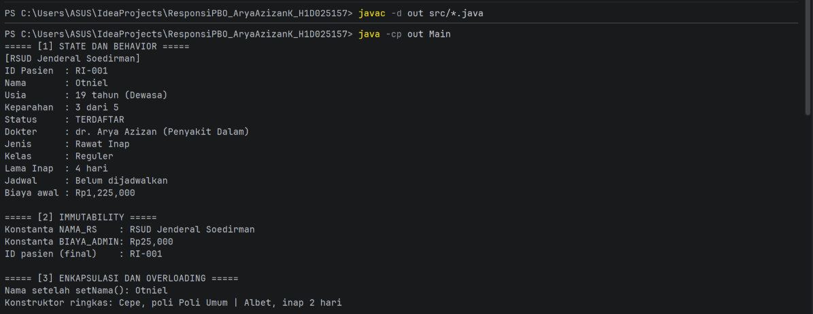
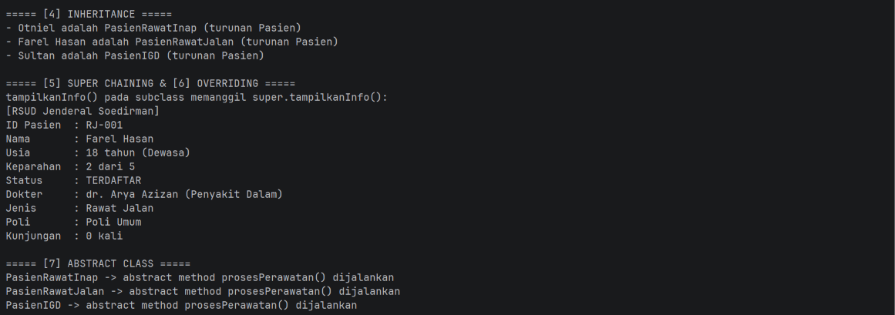
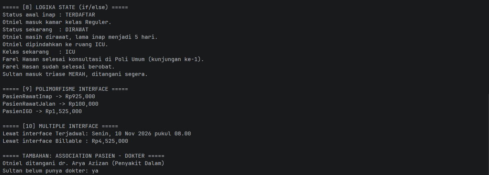

# Sistem Manajemen Pasien Rumah Sakit

## Identitas

- Nama : Arya Azizan K
- NIM  : H1D025157
- Tema : Rumah Sakit (digit terakhir NIM = 7)
- Mata Kuliah : Praktikum Pemrograman Berorientasi Objek (Responsi Akhir)

## Deskripsi

Sistem sederhana pengelolaan pasien rumah sakit berbasis Java. Terdapat tiga
jenis pasien (Rawat Inap, Rawat Jalan, IGD) dengan perhitungan biaya dan proses
perawatan, serta dokter penanggung jawab.

## Struktur Class

| File                  | Keterangan                                  |
|-----------------------|---------------------------------------------|
| Pasien.java           | Abstract class (superclass)                 |
| PasienRawatInap.java  | Subclass, implements Billable dan Terjadwal |
| PasienRawatJalan.java | Subclass, implements Billable               |
| PasienIGD.java        | Subclass, implements Billable               |
| Dokter.java           | Class dokter (association dengan Pasien)    |
| Billable.java         | Interface perhitungan biaya                 |
| Terjadwal.java        | Interface penjadwalan                       |
| Main.java             | Class pengujian 10 persyaratan              |

## Cara Compile dan Run (Terminal)

Pastikan JDK sudah terpasang, lalu dari root proyek:

```bash
javac -d out src/*.java
java -cp out Main
```

Untuk Windows PowerShell:

```powershell
javac -d out (Get-ChildItem src -Filter *.java).FullName
java -cp out Main
```

## Screenshot Luaran

### Output 1


### Output 2


### Output 3

